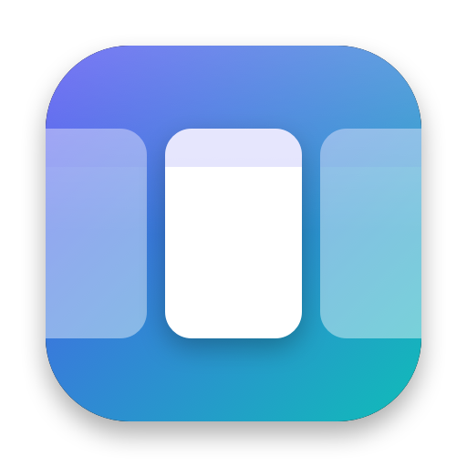

# StripTile

A free window manager for macOS that keeps your windows in one sliding row. Open an app and it joins the row next to the window you are using; four fingers slide along it. Website: https://rathodkunj2005.github.io/striptile/

<p align="center"></p>

## What it does

- **One row per display.** New windows open beside the focused one. Existing windows keep their size.
- **Four-finger swipe.** Continuous pan with coasting, then a snap to the nearest column. Sideways only, so vertical four-finger gestures stay with macOS.
- **Window picker** (⌃⌥Space). Fuzzy search over every window by app and title.
- **Row overview** (⌃⌥O). Every column to scale, selectable by keyboard or click.
- **Per-app rules.** Tile, float or ignore an app, and set the width its windows open at.
- **Pinned side window** (⌃⌥P). One window fixed to the left or right edge while the row scrolls beside it.
- **Stacks, floats, widths.** Stack windows into a column, float one above the row, cycle ½ · ⅔ · full.
- **Row memory.** Order, widths and stacks come back after a restart.
- **Settings window.** Spacing, swipe speed and direction, per-app rules, and every shortcut can be rebound.

Default shortcuts hold ⌃⌥ and press: ←/→ focus, ⇧←/⇧→ swap, R width, F fill, C center, [ ] stack, ⇧[ ⇧] pop out, T float, P pin, N next display, Space picker, O overview.

## Install

1. Download `StripTile.zip` from the [latest release](https://github.com/rathodkunj2005/striptile/releases/latest) and move StripTile to Applications.
2. The build is not notarized. Control-click the app, choose Open, then confirm.
3. Grant Accessibility: System Settings → Privacy & Security → Accessibility.
4. For the swipe, turn off macOS's four-finger swipe between full-screen apps: System Settings → Trackpad → More Gestures. The menu bar icon warns while it is still on.

Requires macOS 13 or later. The release is built for Apple silicon; on Intel, build from source.

## Build from source

```sh
./bundle.sh                 # builds build/StripTile.app, ad-hoc signed
swift run StripCheck        # runs the layout engine checks
```

The Command Line Tools are enough. There is no Xcode project.

An ad-hoc signature changes with every build, and macOS drops the Accessibility grant when it does. Run `./tools/make_signing_identity.sh` once to create a local self-signed certificate in your login keychain. `bundle.sh` then signs with it automatically, and rebuilds keep their permission. Without it you must toggle StripTile off and on in the Accessibility list after every build.

## How it is put together

- `Sources/StripCore` is the layout engine: columns, focus, stacking, scrolling, snapping, row restore and fuzzy search. It has no AppKit dependency and is covered by `StripCheck`.
- `Sources/StripTile` is the app: Accessibility window tracking (`WindowManager`), global shortcuts, the trackpad reader (`SwipeScroll`), the picker, the overview and the SwiftUI settings window.
- `docs/` is the website, served by GitHub Pages.

## Limitations

- The swipe reads raw touches through Apple's private MultitouchSupport framework. A macOS update can break it; keyboard shortcuts do not depend on it.
- The touch layout offsets were checked on one trackpad. Report misbehavior with your Mac model.
- Desktop (Spaces) switching is not implemented. It needs private APIs.
- Apps that refuse to be resized will sit in the row at their own size.
- The window picker and overview show icons and titles, not live thumbnails. Thumbnails would need Screen Recording permission.

## Privacy

StripTile contains no networking code and collects nothing. Accessibility is used to read and move windows and for nothing else. Settings live in macOS user defaults, the saved row in `~/Library/Application Support/StripTile/row.json`, and a short lifecycle log in `~/Library/Logs/StripTile.log`.

## Credits

The idea of a scrolling window row comes from niri, PaperWM and Paneru. StripTile shares no code with them.

## License

MIT. See [LICENSE](LICENSE). The website font, Bricolage Grotesque, is licensed under the SIL Open Font License.
